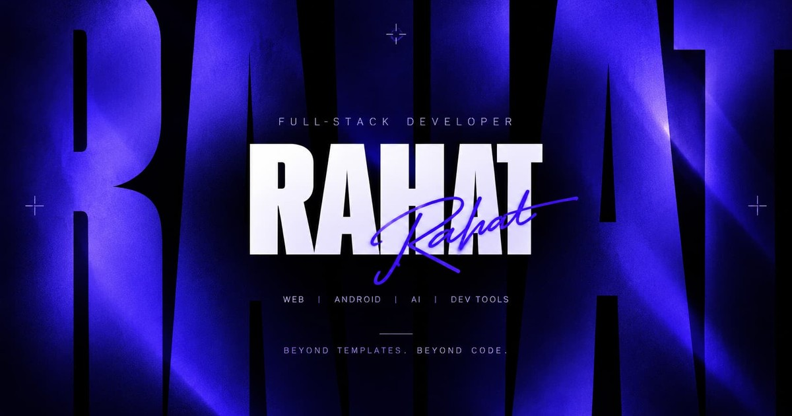
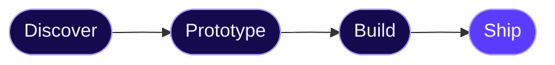
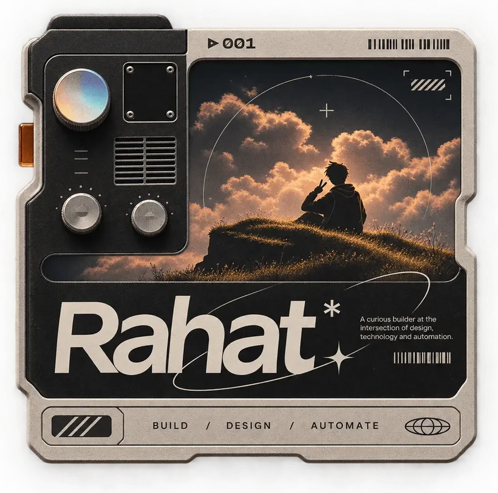
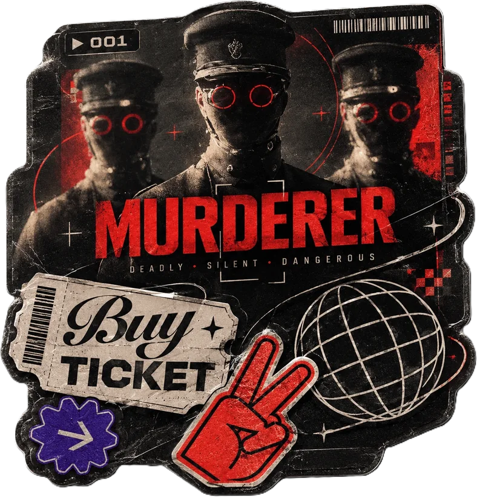
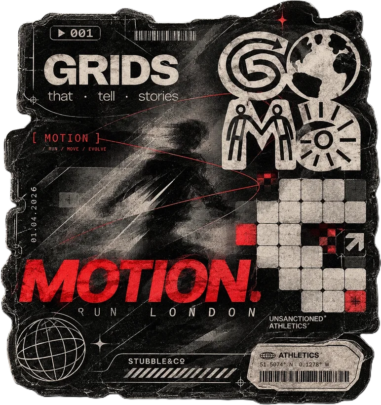
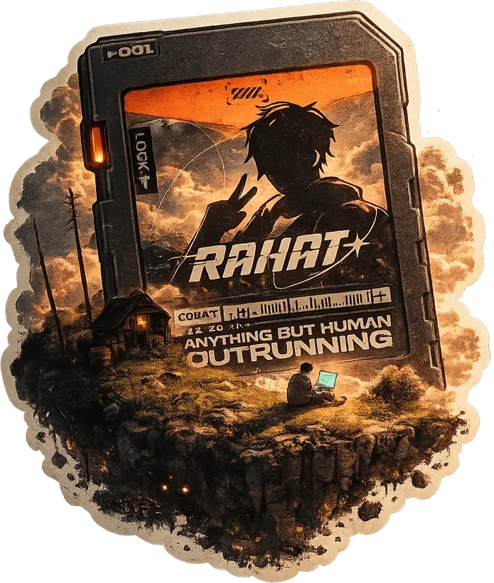
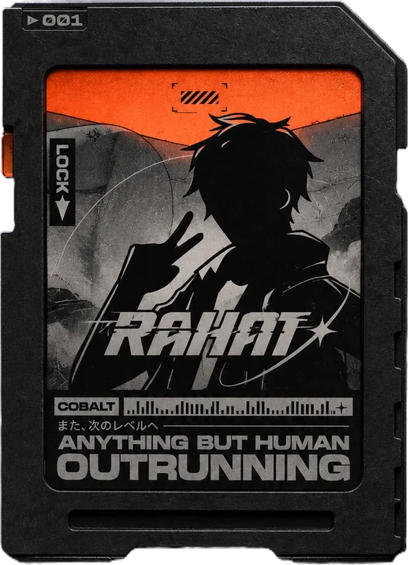

<div align="center">

<a href="https://rahat-port.vercel.app">
  
</a>

<br>

# Rahat Hasan

### Beyond templates. Beyond code.

An interactive portfolio you can play with: a build machine with working parts, a turning 3D knot, and free stickers to take home.

<br>

[](https://rahat-port.vercel.app)


<br>

[**What's inside**](#whats-inside) · [**The build machine**](#the-build-machine) · [**Run it**](#run-it) · [**Make it yours**](#make-it-yours)

</div>

<br>

## What's inside

| | |
|---|---|
| 🌌 **Intro** | A pixel-mark loader flies into the logo, then the hero reveals: glow, arc, and a portrait that sharpens out of the dark. |
| 🧱 **Stack** | *One person. Every layer. Zero hand-offs.* A dithered ribbon and three live-counting cards. |
| 🗂️ **Work** | Brudcode, TruckPai and open source, with previews that follow your cursor. |
| 🕹️ **Process** | An isometric build machine where every part works. See below. |
| ✍️ **Contact** | A fill-in-the-blanks sentence form next to a real-time 3D knot over live letters. |
| 🎁 **Stickers** | A free sticker board. Tap any sticker to download it as a PNG. |

<br>

## The build machine

The Process section is a small machine made entirely in SVG and JavaScript. Idea in, product out.



- **Flip the switch** to power it on or off.
- **Throw the lever** to move to the next stage.
- **Press the keys** and watch the printer print a different sheet every time.
- **Drag any part.** It stays connected by cable, and springs back if you pull too far.
- Every control has its own soft sound.

<br>

## Free stickers

<div align="center">
  
  
  
  
  
</div>

<br>

Seven stickers, all downloadable from the site as transparent PNGs.

<br>

## Built with

| | |
|---|---|
| **Page** | HTML, CSS and plain JavaScript. No framework, no build step. |
| **Motion** | GSAP and ScrollTrigger, with Lenis for smooth scrolling. |
| **3D** | A Blender-modelled knot, rendered in the browser with Three.js. |
| **Machine** | Hand-generated isometric SVG. |
| **Type** | Onest and Geist Mono. |
| **Palette** | `#06040f` black · `#5b3cff` violet · `#a99bff` lavender · `#f4f2ff` ink |

<br>

## Run it

```bash
git clone https://github.com/twaseenmustafa/Demo-Portfolio.git
cd Demo-Portfolio
python -m http.server 5173
```

Then open <http://localhost:5173>. Use a local server, because the page loads ES modules.

<br>

## Files

```text
index.html    page and content
style.css     all styles
main.js       loader, scroll motion, form, sounds
machine.js    the Process build machine
knot.js       the 3D knot
assets/       images, stickers, sounds, 3D model, share image
blender/      the knot's Blender source
```

<br>

## Make it yours

1. Swap `assets/rahat-portrait.webp` for your own cut-out portrait.
2. Replace the placeholder email and LinkedIn link in `index.html`.
3. Connect the contact form to a service such as Formspree (search for `shortcut:` in `main.js`).

<br>

<div align="center">

**[Open the live site →](https://rahat-port.vercel.app)**

</div>
