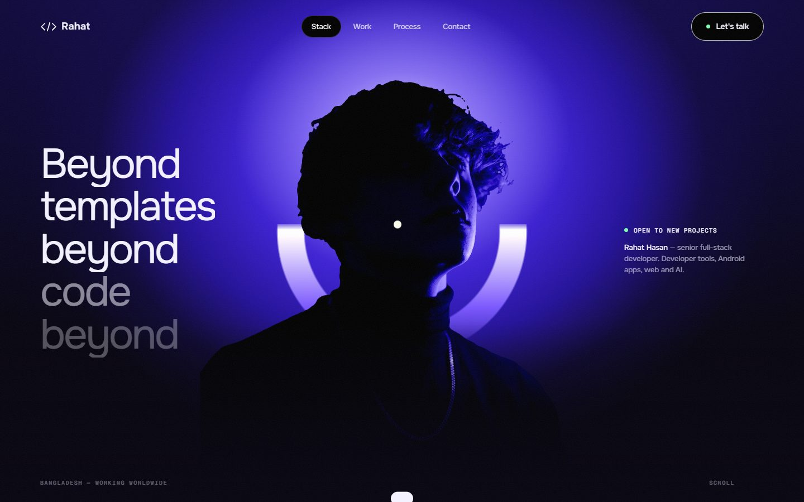

<div align="center">

<a href="https://dempo-blond.vercel.app">
  
</a>

# Rahat Hasan

**Senior full-stack developer. Beyond templates, beyond code, beyond.**

[**Live site →**](https://dempo-blond.vercel.app)

</div>

---

## What's on the site

- **Intro:** a pixel-mark loader hands off to a layered, parallax hero.
- **Stack:** one person, every layer, zero hand-offs.
- **Work:** Brudcode, TruckPai and open source, with hover previews.
- **Process:** an interactive build machine. Flip the switch, throw the lever, print a sheet, ship.
- **Contact:** a fill-in-the-blanks form beside a turning 3D knot.
- **Stickers:** a free sticker board. Tap one to download it.

## Built with

HTML, CSS and plain JavaScript. GSAP and ScrollTrigger for motion, Lenis for smooth scroll, Three.js for the 3D knot. No build step.

## Run it

```bash
git clone https://github.com/twaseenmustafa/Demo-Portfolio.git
cd Demo-Portfolio
python -m http.server 5173
```

Open <http://localhost:5173>.

## Files

```
index.html   page and content
style.css    styles
main.js      loader, scroll motion, form, sounds
machine.js   the Process machine
knot.js      the 3D knot
assets/      images, stickers, sounds, knot model
blender/     knot source file
```

## Before you launch

- Connect the contact form to a service like Formspree (search `shortcut:` in `main.js`).
- Replace the placeholder email and LinkedIn link in `index.html`.
